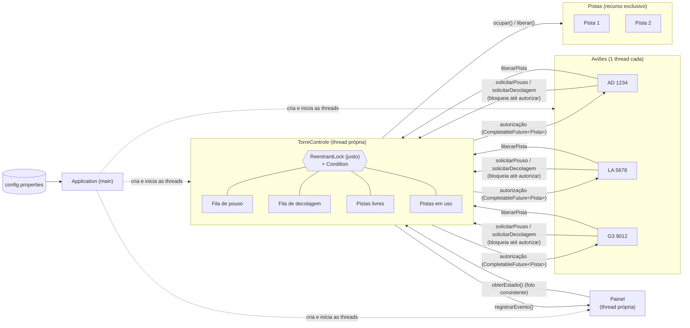
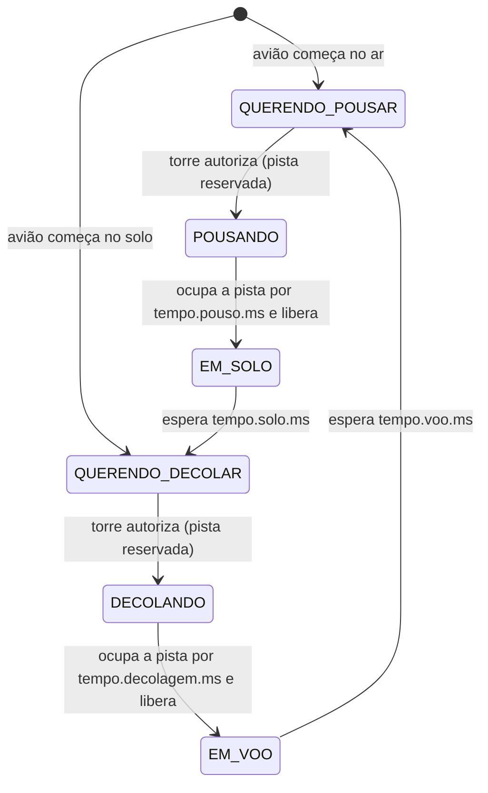
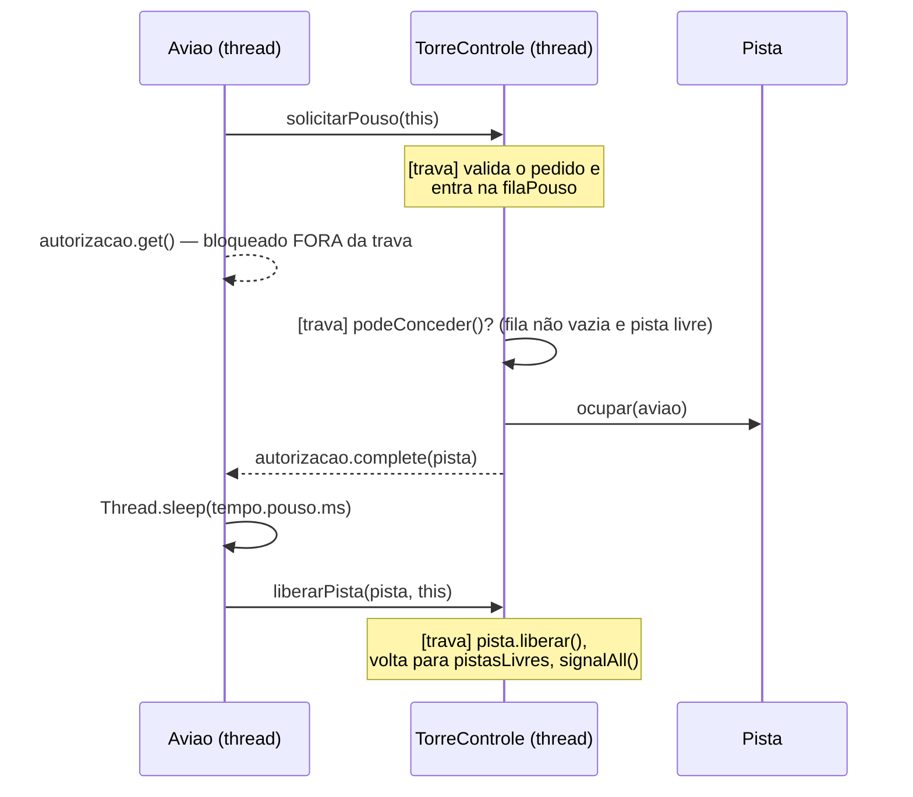

# ✈️ Simulador de Aeroporto Concorrente

Projeto de Concorrência — 2ª VA de Paradigmas da Programação (UFRPE, 2026.2).

Simulador em tempo real de um aeroporto pequeno, com saída textual animada no terminal. Cada avião é uma *thread* independente que conversa apenas com a **torre de controle**; a torre é quem decide quem usa cada **pista** (recurso compartilhado de acesso exclusivo). A simulação nunca termina: o avião que pousou espera um tempo no solo, pede para decolar, voa um tempo e pede para pousar de novo.

**Equipe 3**

- Yann Tavares de Santana
- Tomaz Bruno Aureliano de Santanna Vieira
- Lucas Gabriel da Silva Andrade
- João Vítor de Souza Santos

---

## Sumário

1. [Como executar](#1-como-executar)
2. [Arquitetura](#2-arquitetura)
3. [Principais partes do sistema](#3-principais-partes-do-sistema)
4. [Controle de concorrência](#4-controle-de-concorrência)
5. [Exceções e asserções](#5-exceções-e-asserções)
6. [Como desativar o controle e provocar as exceções](#6-como-desativar-o-controle-e-provocar-as-exceções)
7. [Configuração](#7-configuração)
8. [Código existente utilizado](#8-código-existente-utilizado)
9. [Uso de IA Generativa](#9-uso-de-ia-generativa)

---

## 1. Como executar

**Requisitos:** JDK 17 ou superior (o `pom.xml` compila com `release 17`; o *devcontainer* do repositório usa Java 21) e Maven. Nenhuma dependência externa é necessária.

**Com Maven** (já liga as asserções com `-ea`):

```bash
# configuração padrão (config.properties)
mvn -q compile exec:exec

# escolhendo a configuração
mvn -q compile exec:exec -Dconfig=configs/c1.properties   # C1: 3 pousos, 3 decolagens, 2 pistas
mvn -q compile exec:exec -Dconfig=configs/c2.properties   # C2: 4 pousos, 1 pista
```

**Sem Maven:**

```bash
javac -encoding UTF-8 -d target/classes $(find src -name '*.java')
java -ea -Dfile.encoding=UTF-8 -cp target/classes com.airport.simulator.Application configs/c1.properties
```

Pare a simulação com `Ctrl+C`. Se rodar em um console que não interpreta códigos ANSI (ex.: console do IntelliJ), use `painel.limpar-tela=false` no arquivo de configuração.

---

## 2. Arquitetura

### Visão geral dos componentes



Os aviões **não se comunicam entre si**: toda interação passa pela torre. O painel só *lê* o estado, e o faz através de uma foto imutável tirada sob a trava da torre.

### Ciclo de vida de cada avião



### Sequência de um pedido de pouso



---

## 3. Principais partes do sistema

Estrutura do código (`src/main/java/com/airport/simulator/`):

```
Application.java          ponto de entrada: monta tudo e inicia as threads
config/Configuracao.java  leitura e validação do arquivo .properties
model/Aviao.java          thread do avião (ciclo de vida)
model/StatusAviao.java    estados do avião
model/Pista.java          pista com ocupar()/liberar()
service/TorreControle.java  coordenadora central (filas, trava, política)
service/Solicitacao.java    pedido de um avião (+ CompletableFuture da autorização)
service/TipoSolicitacao.java POUSO | DECOLAGEM
service/EstadoTorre.java    foto imutável do estado, usada pelo painel
view/Painel.java          painel de controle no terminal
exception/ColisaoException.java        dois aviões na mesma pista
exception/EstadoInvalidoException.java invariante do sistema violada
```

### `Application`
Lê o arquivo de configuração (o caminho pode vir como argumento), cria as pistas, a torre, os aviões e o painel, e inicia **uma thread para cada um**. Os números de voo são sorteados com prefixos de empresas brasileiras (`AD` Azul, `LA` LATAM, `G3` GOL, `2Z` Passaredo), sem repetição, por exemplo `AD 2774`. Também registra um `UncaughtExceptionHandler` global: qualquer exceção não tratada em qualquer thread (`ColisaoException`, `EstadoInvalidoException`, `AssertionError`…) para o painel, mostra **qual thread falhou e por quê** e encerra o programa.

### `Aviao` (thread)
Implementa `Runnable` e executa um laço infinito sobre o seu `StatusAviao`, seguindo o ciclo do diagrama acima. Em `QUERENDO_POUSAR`/`QUERENDO_DECOLAR` ele chama a torre e **bloqueia** até receber a pista; usa a pista (simulada com `Thread.sleep`) e, em um `finally`, sempre avisa a torre que a liberou, mesmo se for interrompido.

### `Pista`
Recurso compartilhado de acesso exclusivo. `ocupar()` lança `ColisaoException` se a pista já estiver ocupada, e `liberar()` tem uma asserção garantindo que só se libera pista ocupada. A pista **não se protege sozinha**: a exclusão mútua é garantida pela torre, e a pista funciona como "última linha de defesa" que denuncia a falha.

### `TorreControle` (thread + monitor)
Coordenadora central. Mantém:

- `filaPouso` e `filaDecolagem` (ordem de chegada, FIFO);
- `pistasLivres` e `pistasEmUso` (qual solicitação ocupa cada pista).

Sua própria thread espera até existir **pedido na fila e pista livre**, escolhe o próximo pedido, reserva a pista e acorda o avião escolhido.

**Política de escolha:** o pouso tem prioridade (o avião está no ar), mas depois de `torre.max-pousos-consecutivos` pousos seguidos, se houver decolagem esperando, ela é atendida. Isso evita **inanição** das decolagens.

### `Painel` (thread)
Redesenha o terminal a cada `painel.intervalo.ms` (padrão 1 s, configurável) mostrando: hora, estado das pistas, fila de pouso, fila de decolagem, status de cada avião e as últimas 12 mensagens da simulação (com horário em milissegundos). O desenho é montado em um único `StringBuilder` e impresso de uma vez, para a tela não piscar.

### `Configuracao`
`record` com todos os parâmetros. Valida os valores (ex.: pelo menos 1 pista, tempos não negativos) e falha com mensagem clara se alguma chave estiver faltando ou inválida.

---

## 4. Controle de concorrência

| Mecanismo | Onde | Para quê |
|---|---|---|
| `ReentrantLock(true)` (trava **justa**) | `TorreControle.trava` | Protege **todo** o estado interno da torre (filas, pistas livres, pistas em uso). Como a trava é justa, nenhuma thread é preterida indefinidamente. |
| `Condition` (`await` / `signalAll`) | `TorreControle.haTrabalho` | A thread da torre dorme enquanto não há pedido + pista livre. É acordada quando entra um pedido (`solicitar`) ou quando uma pista é liberada (`liberarInterno`). Evita *busy-waiting*. |
| `CompletableFuture<Pista>` | `Solicitacao.autorizacao` | O avião espera a autorização com `get()` **fora da trava**, para não travar a torre nem os outros aviões. A torre autoriza com `complete(pista)`. |
| Foto imutável (`record EstadoTorre`) | `TorreControle.obterEstado()` | O painel lê um retrato **consistente** do estado, tirado sob a trava, sem enxergar as estruturas internas. |
| `volatile` | `Aviao.status` | O status é lido pelo painel e escrito pelas threads do avião e da torre. |
| `ConcurrentLinkedDeque` | `Painel.mensagens` | Várias threads registram mensagens ao mesmo tempo. |
| `AtomicBoolean` | `Application.falhaRelatada` | Garante que apenas a **primeira** falha seja relatada quando várias threads falham juntas. |

**Por que não há *deadlock*?** Existe uma única trava, e nenhuma thread espera por outro recurso enquanto a segura: o avião só aguarda a autorização depois de soltar a trava, e a torre libera a trava ao fazer `await`.

**Interrupção:** se um avião for interrompido enquanto espera, `cancelarSolicitacao()` tira o pedido da fila ou, se a torre acabou de concedê-lo, devolve a pista para não "perdê-la".

---

## 5. Exceções e asserções

### Exceções

| Exceção | Quando é lançada |
|---|---|
| `ColisaoException` | Dois aviões tentam ocupar a mesma pista (`Pista.ocupar()`). A mensagem informa a pista e o avião que já a ocupava. |
| `EstadoInvalidoException` | Pedido com status incompatível; avião que já está em fila ou pista pedindo de novo; liberar pista que não estava em uso; avião liberando pista de outro avião. |

Qualquer exceção em qualquer thread é capturada por `Application.relatarFalhaEEncerrar`, que exibe a thread, o tipo da exceção, o **motivo** e o *stack trace*, e encerra a simulação.

### Asserções (rodam com `java -ea`)

A equipe tem 4 integrantes, então há no mínimo 4 asserções distintas (são 5):

| # | Local | O que garante |
|---|---|---|
| 1 | `Pista.liberar()` | Só se libera uma pista que estava ocupada. |
| 2 | `TorreControle.verificarInvariantes()` | Nenhuma pista some nem é duplicada: `livres + em uso = total`. |
| 3 | `TorreControle.verificarInvariantes()` | Uma pista nunca está ao mesmo tempo livre e em uso. |
| 4 | `TorreControle.verificarInvariantes()` | Cada avião aparece em no máximo um lugar (uma fila **ou** uma pista). |
| 5 | `TorreControle.verificarInvariantes()` | Quem está na pista tem status coerente (`POUSANDO` ou `DECOLANDO`) com a operação autorizada. |

`verificarInvariantes()` é chamado depois de toda mudança de estado (ao conceder e ao liberar uma pista), sempre com a trava adquirida. As linhas relevantes estão marcadas no código com `[ASSERCAO n]` e `[CONTROLE-CONCORRENCIA]`.

---

## 6. Como desativar o controle e provocar as exceções

O ponto que sustenta a exclusão mútua das pistas é a retirada da pista concedida da lista de livres:

**`src/main/java/com/airport/simulator/service/TorreControle.java`, linha 242**

```java
pistasLivres.removeFirst();   // [CONTROLE-CONCORRENCIA] comentar esta linha desativa o controle
```

**Experimento:** comente essa linha (`// pistasLivres.removeFirst();`) e rode a configuração C1. A pista concedida continua constando como "livre", então a torre a concede de novo enquanto ela está ocupada. O resultado depende de como a JVM foi iniciada:

| Execução | Exceção | Mensagem (exemplo real) |
|---|---|---|
| `java -ea` (asserções ligadas) | `AssertionError` ([ASSERCAO 2], linha 302) logo na 1ª autorização | `Contagem de pistas inconsistente: 2 livre(s) + 1 em uso, mas o aeroporto tem 2` |
| `java` (sem `-ea`) | `ColisaoException` (`Pista.ocupar()`, linha 30) quando a pista é concedida de novo | `Pista Pista 1 já está ocupada por 2Z 6593` |

Nos dois casos a simulação para e a tela mostra a thread que falhou e o motivo.

---

## 7. Configuração

A simulação é definida por um arquivo `.properties` (padrão: `config.properties`; outro arquivo pode ser passado como argumento). **Todos os tempos são em milissegundos.**

| Chave | Significado |
|---|---|
| `avioes.pousar` | Aviões que começam no ar, querendo pousar |
| `avioes.decolar` | Aviões que começam no solo, querendo decolar |
| `pistas` | Quantidade de pistas |
| `tempo.pouso.ms` | Tempo que o avião ocupa a pista ao pousar |
| `tempo.decolagem.ms` | Tempo que o avião ocupa a pista ao decolar |
| `tempo.solo.ms` | Intervalo entre o pouso e o pedido de decolagem |
| `tempo.voo.ms` | Intervalo entre a decolagem e o novo pedido de pouso |
| `painel.intervalo.ms` | Taxa de atualização do painel (padrão: 1000) |
| `painel.limpar-tela` | Se o painel limpa a tela a cada atualização (`false` em consoles sem ANSI) |
| `torre.max-pousos-consecutivos` | Pousos seguidos antes de deixar uma decolagem passar (anti-inanição) |

Configurações prontas em `configs/`:

- **C1** (`configs/c1.properties`): 3 aviões para pousar, 3 para decolar, 2 pistas.
- **C2** (`configs/c2.properties`): 4 aviões querendo pousar, 1 pista.

---

## 8. Código existente utilizado

O projeto usa apenas a biblioteca padrão do Java (`java.util.concurrent`, `java.time`, `java.nio`); não há dependências externas (o `pom.xml` só configura o `exec-maven-plugin` para facilitar a execução). *Nenhum trecho de código de terceiros ou de projetos existentes foi copiado.*

---

## 9. Uso de IA Generativa

> ⚠️ **PREENCHER (equipe):** o professor exige que se informe **quais partes foram feitas com IA generativa e quais ferramentas e modelos foram usados**. Complete a tabela abaixo com a realidade do grupo; se alguma parte não usou IA, escreva "nenhuma". Itens sem informação devem ser removidos antes da entrega.

| Parte do projeto | Usou IA? | Ferramenta e modelo | O que foi feito com a IA |
|---|---|---|---|
| `TorreControle` (trava, filas, política) | _preencher_ | _ex.: Claude (Anthropic), modelo X_ | _preencher_ |
| `Aviao` / `Pista` / `StatusAviao` | Sim | Gemini | ajudou a debuggar o ciclo de vida do avião, uso correto dos try/catch |
| `Painel` | _preencher_ | _preencher_ | _preencher_ |
| `Configuracao` / `Application` | _preencher_ | _preencher_ | _preencher_ |
| Exceções e asserções | _preencher_ | _preencher_ | _preencher_ |
| Diagramas e este `README.md` | Sim | Claude (Anthropic) | Redação do README e dos diagramas a partir da leitura do código do repositório; revisado pela equipe. |
